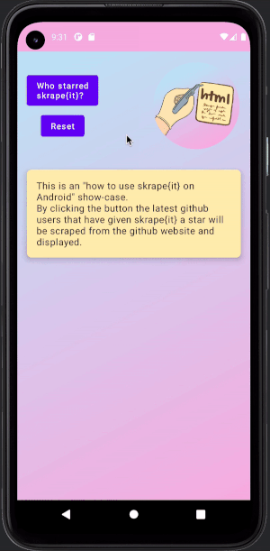

# skrape{it} Android example

This Jetpack Compose app scrapes GitHub stargazers. It also verifies that the current library's
published JARs work on Android, including an R8-optimized release.



Use JDK 25, Android SDK Platform 37 and an API 36 emulator. The app uses AGP 9.4.1 with built-in
Kotlin 2.4.21, targets Java 17 bytecode and has `minSdk = 26`. Set `ANDROID_HOME` to your SDK
or create `examples/android/local.properties` with `sdk.dir=/absolute/path/to/your/sdk`.

From the repository root:

```shell
./gradlew publishToMavenLocal -Dmaven.repo.local="$PWD/build/maven-smoke-test"
./gradlew -p examples/android :app:assembleRelease :app:lintRelease
```

The consumer resolves `it.skrape` exclusively from `build/maven-smoke-test`, so it cannot silently
fall back to an old Maven Central release. To use another local publication, pass
`-PskrapeitRepository=/absolute/path/to/repository -PskrapeitVersion=your-version`.

With an emulator running:

```shell
./gradlew -p examples/android :app:connectedReleaseAndroidTest
```

Instrumentation tests cover HTML parsing, synchronous HTTP, coroutine-based HTTP and JavaScript
rendering with `BrowserFetcher`. Network fixtures run on the device's loopback interface; no
external website is needed. HTTP cleartext is allowed only for localhost. The release is minified
and resource-shrunk, and uses the debug signing key solely to allow installation of this example.
The instrumentation entry point is kept; R8 still processes the library code.
The fetcher JARs supply their own consumer rules for reflection. Applets, AWT canvas rendering
and the excluded Jetty WebSocket transport are unavailable on Android.

For an application consuming a published release:

```kotlin
android {
    compileOptions {
        sourceCompatibility = JavaVersion.VERSION_17
        targetCompatibility = JavaVersion.VERSION_17
    }
    packaging.resources.excludes += setOf("META-INF/DEPENDENCIES", "META-INF/INDEX.LIST")
    packaging.resources.pickFirsts += "mozilla/public-suffix-list.txt"
}

dependencies {
    implementation("it.skrape:skrapeit:$skrapeVersion")
}
```

Declare `android.permission.INTERNET` in the manifest for network requests. Run blocking fetchers
on `Dispatchers.IO` to avoid `NetworkOnMainThreadException`.
